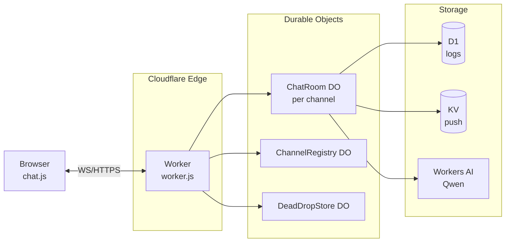

> 🌐 **English** | [한국어](./README.md)

> ℹ️ This is an English translation of [README.md](./README.md). The Korean version is canonical and may be more up to date.

# Anonymous Chat

> **Anonymous real-time chat platform built on Cloudflare Workers**

[](./COMMERCIAL_LICENSE.md)
[](./SECURITY.md)
[](./docs/DEVELOPMENT.md)

An anonymous chat service built with Cloudflare Workers · Durable Objects · D1 · Workers AI.
Join instantly with just a nickname — no sign-up — and **all messages are automatically destroyed after 12 hours**.

---

## Table of Contents

1. [Features](#features)
2. [Tech Stack](#tech-stack)
3. [Quick Start](#quick-start)
4. [Project Structure](#project-structure)
5. [Architecture](#architecture)
6. [Security](#security)
7. [Development Commands](#development-commands)
8. [Docs Index](#docs-index)

---

## Features

### User Features

| Feature | Description |
|---|---|
| Instant join | Start with just a nickname, no sign-up |
| Real-time messaging | Instant delivery over WebSocket |
| 9 themes | dark · light · midnight · amethyst · sunset · sakura · evernight · ocean · forest |
| Message reactions | 6 emoji (double-click for quick like) |
| Replies | Original preview + secret message (Dead Drop) option |
| File sharing | Images/videos/audio/documents, up to **100MB** |
| AI summaries | 4 modes: `/summary` · `/topic` · `/mood` · `/conflict` |
| Message search | Keywords + tags (`#images` · `#files` · `#code` · `#url`) |
| Link previews | Automatic OG tag parsing + security header analysis |
| Code highlighting | Single Prism.js stack (npm self-hosted bundle · no CDN) |
| Multiple channels | Independent chat rooms per topic |
| Announcements | Normal/urgent announcements + scheduling |
| Push notifications | VAPID Web Push + FCM |
| PWA | Add to home screen · offline shell · share target |

### Admin Features

| Feature | Description |
|---|---|
| Message management | Edit · delete · purge all |
| User bans | Dual IP + SessionID (temporary/permanent) |
| Announcement management | Send · edit · delete · urgent · expire |
| Channel management | List · details · force delete |
| Audit logs | D1 storage · filtering · CSV export · `audit_logs` 90-day / `admin_activity_logs`·`error_logs` 30-day retention (cleanup forced every 10 writes) |
| Error tracking | Automatic collection · download · reset |
| Login history | Success/failure/block/logout |

### Security Features

| Feature | Description |
|---|---|
| HMAC message signing | Prevents client → server message tampering |
| HMAC auth tokens | Opaque random tokens + KV sessions (not JWT) |
| Rate limiting | Multi-layered: global + per-endpoint + per-user |
| Cloudflare Turnstile | Bot prevention · `/ws` connections require an HMAC ticket (2 hours) bound to the join sessionId |
| WS origin validation | Origin header required (fail-closed) |
| Admin API rate limit | 120 requests/min per IP for `/api/admin/*` |
| Observer tickets | Admin observer WebSockets connect with a 5-minute single-use ticket (`POST /api/admin/observer-ticket`) (admin token never exposed in URLs) |
| File proxy | Documents (SVG/HTML/PDF) served as `attachment` + `nosniff` + CSP; only raster images inline |
| Security headers | CSP · HSTS · COOP · COEP · no `unsafe-inline`/`unsafe-eval` · cdnjs not allowed |
| Dead Drop | 30-minute TTL · permanently deleted after a single read |
| Auto-expiry | Messages after 12 hours · bans auto-expire |

---

## Tech Stack

| Area | Technology |
|---|---|
| **Runtime** | Cloudflare Workers (Static Assets) |
| **State** | Durable Objects (3: `ChatRoom`, `ChannelRegistry`, `DeadDropStore`) |
| **DB** | Cloudflare D1 (logs) · KV (push subscriptions, ephemeral state) |
| **AI** | Workers AI · Qwen 3 30B-A3B · Qwen 1.5 7B fallback |
| **Push** | Web Push (VAPID) + FCM v1 |
| **Build** | esbuild (10 bundles: chat · admin · security center · admin pages) |
| **Tests** | Vitest (611 cases · 41 files) |
| **Linting** | ESLint + Prettier |
| **Frontend** | Vanilla JS (modular) · CSS Custom Properties themes · Tailwind (build) |

---

## Quick Start

### Step 1: Requirements

- Node.js **18+**
- Cloudflare account
- Wrangler CLI (`npm install -g wrangler`)

### Step 2: Installation

```bash
git clone <repo>
cd Anonymous_Chat
npm install
cp .dev.vars.example .dev.vars
```

### Step 3: Dev Server

```bash
npm run dev
# → http://localhost:8788
```

### Step 4: Build & Verify

```bash
npm run build      # client bundle (esbuild)
npm test           # 611 unit tests (41 files)
npm run lint       # ESLint
```

### Step 5: Deployment

Details: [docs/DEPLOYMENT.en.md](./docs/DEPLOYMENT.en.md)

```bash
npm run deploy
wrangler d1 create anonymous-chat-db            # one-time (always created on the remote account)
wrangler d1 migrations apply anonymous-chat-db --remote
```

---

## Project Structure

```
.
├── src/                          # Worker (server)
│   ├── worker.js                 # main router (558 lines)
│   ├── schema.js                 # JSDoc type definitions
│   ├── config/                   # constants/config
│   ├── handlers/                 # HTTP handlers
│   ├── durable-objects/          # 3 DO classes
│   │   ├── ChatRoom.js           # WebSocket chat (1632 lines)
│   │   ├── ChannelRegistry.js    # channel metadata
│   │   ├── DeadDropStore.js      # secret messages
│   │   └── chat-room/            # ChatRoom helpers
│   ├── utils/                    # utilities (validate, errors, ...)
│   └── middleware/               # auth middleware
│
├── public/                       # static assets + client
│   ├── index.html                # main chat
│   ├── administrator.html        # admin dashboard
│   ├── announcements.html        # announcement history
│   ├── help.html                 # user guide
│   ├── privacy.html              # privacy policy
│   ├── sw.js                     # Service Worker
│   ├── manifest.json             # PWA manifest
│   ├── _headers                  # security headers
│   ├── js/                       # client modules
│   │   ├── chat.js               # main (1144 lines)
│   │   ├── chat-page.js          # chat page bootstrap (sidebar/nickname placement)
│   │   ├── announcements-page.js # announcements page bootstrap (urgent announcement polling/redirect)
│   │   ├── ui.js + ui-*.js       # UI manager + 5 mixins
│   │   ├── admin-core.js + admin-ui.js + admin-main.js + security-center.js # admin (hash router)
│   │   ├── pages/page-*.js       # 6 admin page modules
│   │   ├── api-client.js         # fetch wrapper
│   │   ├── websocket.js          # WS manager (reconnect, heartbeat, ephemeral signing)
│   │   ├── signature.js          # Web Crypto HMAC-SHA256 signing
│   │   ├── session.js            # session/nickname
│   │   ├── theme.js + theme-init.js # 9 themes · early FOUC prevention
│   │   ├── file-upload.js        # uploads (100MB)
│   │   ├── search.js             # search
│   │   ├── push-manager.js       # VAPID/FCM
│   │   ├── turnstile.js          # Cloudflare Turnstile
│   │   ├── og-preview.js         # OG cards
│   │   ├── security-headers.js   # Kalpha API
│   │   ├── dead-drop.js          # secret messages
│   │   ├── sakura.js             # sakura particles
│   │   ├── evernight.js          # GIF particles
│   │   ├── code-highlight.js     # Prism code highlighting
│   │   └── utils.js              # shared utilities
│   └── css/                      # themes + animations
│
├── test/                         # Vitest 611 cases (41 files)
├── migrations/                   # D1 schema
├── docs/                         # detailed documentation
└── wrangler.toml                 # Cloudflare config
```

---

## Architecture

Details: [docs/ARCHITECTURE.en.md](./docs/ARCHITECTURE.en.md)



### Key Decisions

| Decision | Rationale |
|---|---|
| **WebSockets handled directly in the DO** | Guarantees sticky sessions |
| **HMAC-SHA256 message signing** | Prevents client → DO message tampering |
| **Ephemeral Token model** | Per-session 32-byte secret + capability key (reconnect validation, rotated on every join) |
| **`X-Admin-Internal-Token`** | Worker ↔ DO internal communication (SSRF prevention) |
| **Channel = separate DO instance** | Metadata lives in `ChannelRegistry` |

---

## Security

Full checklist: [docs/SECURITY.md](./docs/SECURITY.md) (Korean) · [SECURITY.md](./SECURITY.md)

| Control | Description |
|---|---|
| D1 parameter binding | SQL injection prevention |
| Constant-time comparison | Timing attack prevention |
| Input sanitization | `sanitizeInput`, `escapeHtml` |
| Message signature verification | HMAC-SHA256 + Ephemeral Token (per-session secret revoked) · ±30-second freshness · reconnect capability key (close 4401) |
| Rate limiting | Multi-layered (120 requests/min for admin routes) |
| Security headers | CSP · HSTS · COOP · COEP · no `unsafe-inline`/`unsafe-eval` · cdnjs not allowed |
| Cloudflare Turnstile | `/ws` connections require an HMAC ticket (2 hours) bound to the join sessionId |
| WS origin validation | Origin header required (fail-closed) |
| SSRF prevention | Internal token |

---

## Development Commands

```bash
npm run dev      # wrangler dev :8788 (local Workers + static assets)
npm test         # vitest run
npm run lint     # eslint
npm run build    # esbuild client bundle
npm run deploy   # build + wrangler deploy (Worker)
```

GitHub Actions and Dependabot are not used (removed 2026-09-16) — verify locally with `npm test` · `npm run lint` · `npx wrangler deploy --dry-run`; deployment is performed automatically by Cloudflare Workers Builds on push.

Details: [docs/DEVELOPMENT.en.md](./docs/DEVELOPMENT.en.md)

---

## Contributing

Contribution process: [CONTRIBUTING.en.md](./CONTRIBUTING.en.md)

---

## License

All rights reserved, including commercial use.
Details: [COMMERCIAL_LICENSE.en.md](./COMMERCIAL_LICENSE.en.md)

**Contact**: dev@kalpha.kr

---

## Docs Index

CHANGELOG and internal design docs are maintained in Korean.

| Document | Purpose |
|---|---|
| [CHANGELOG.md](./CHANGELOG.md) (Korean) | Change history |
| [FEATURE_IDEAS.md](./FEATURE_IDEAS.md) (Korean) | Feature ideas + implementation status |
| [CONTRIBUTING.en.md](./CONTRIBUTING.en.md) | Contribution guide |
| [SECURITY.md](./SECURITY.md) | Security policy |
| [COMMERCIAL_LICENSE.en.md](./COMMERCIAL_LICENSE.en.md) | License |
| [docs/ARCHITECTURE.en.md](./docs/ARCHITECTURE.en.md) | Architecture |
| [docs/API.en.md](./docs/API.en.md) | API reference |
| [docs/SECURITY.md](./docs/SECURITY.md) (Korean) | Security checklist |
| [docs/DEPLOYMENT.en.md](./docs/DEPLOYMENT.en.md) | Deployment guide |
| [docs/DEVELOPMENT.en.md](./docs/DEVELOPMENT.en.md) | Development guide |
| [portfolio/PRESENTATION.md](./portfolio/PRESENTATION.md) (Korean) | Presentation material (for school/portfolio) |
| [portfolio/QNA.md](./portfolio/QNA.md) (Korean) | Presentation Q&A collection (in-depth answers) |
