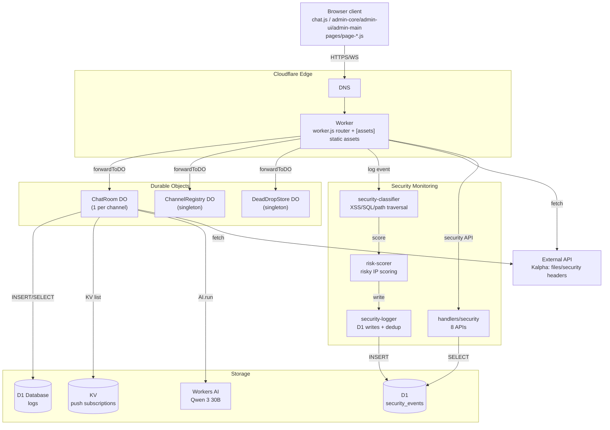
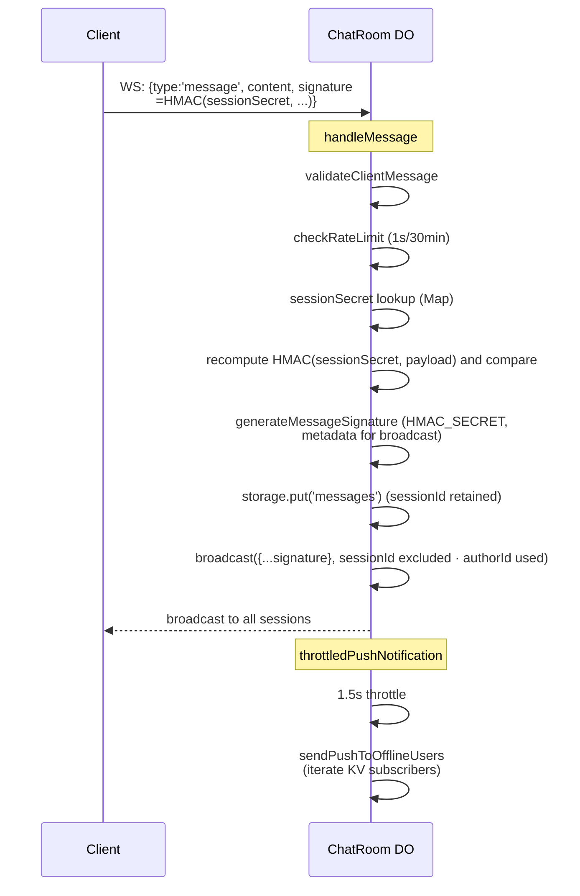
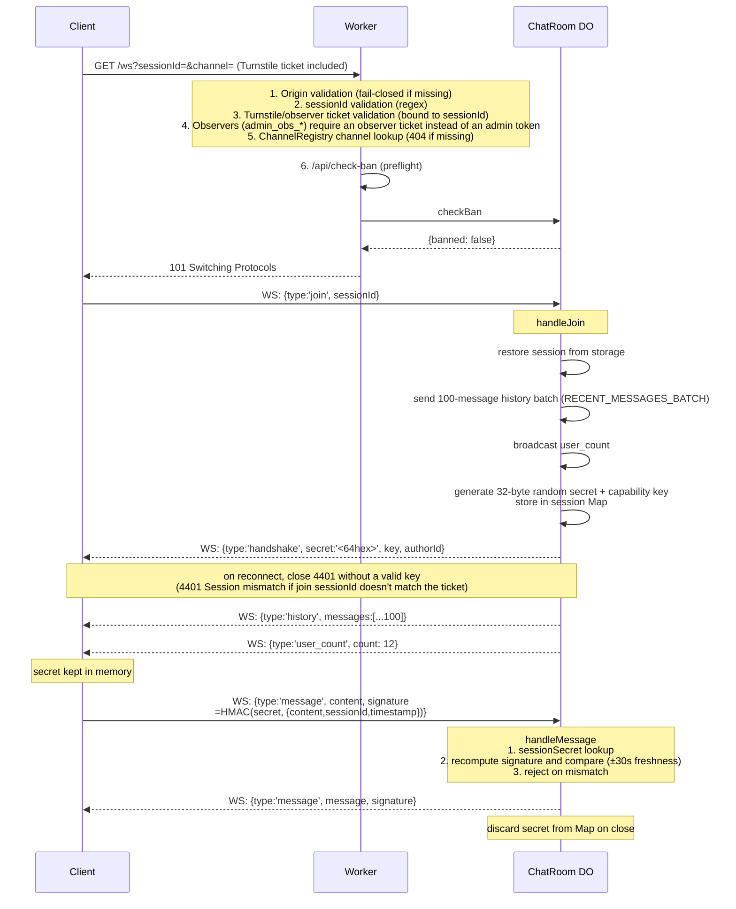
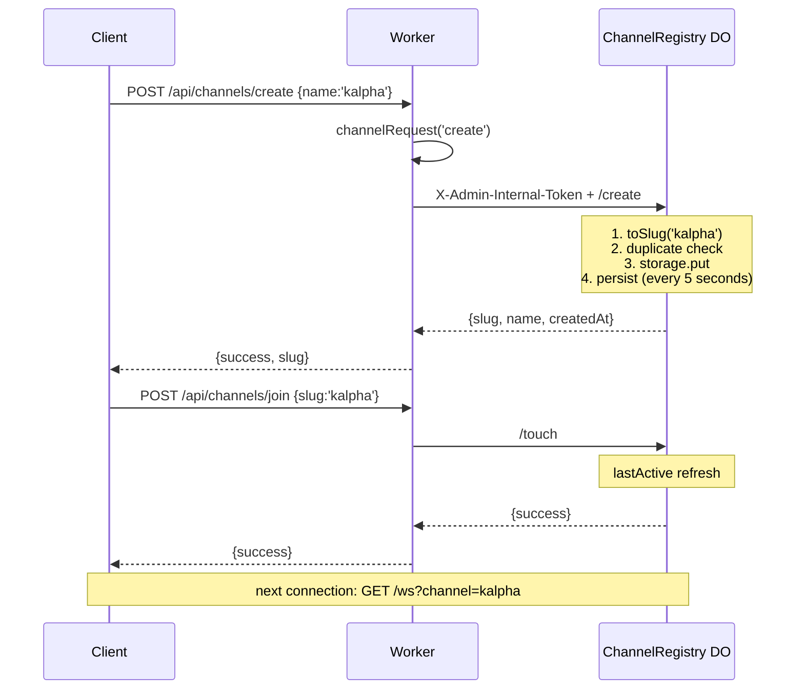
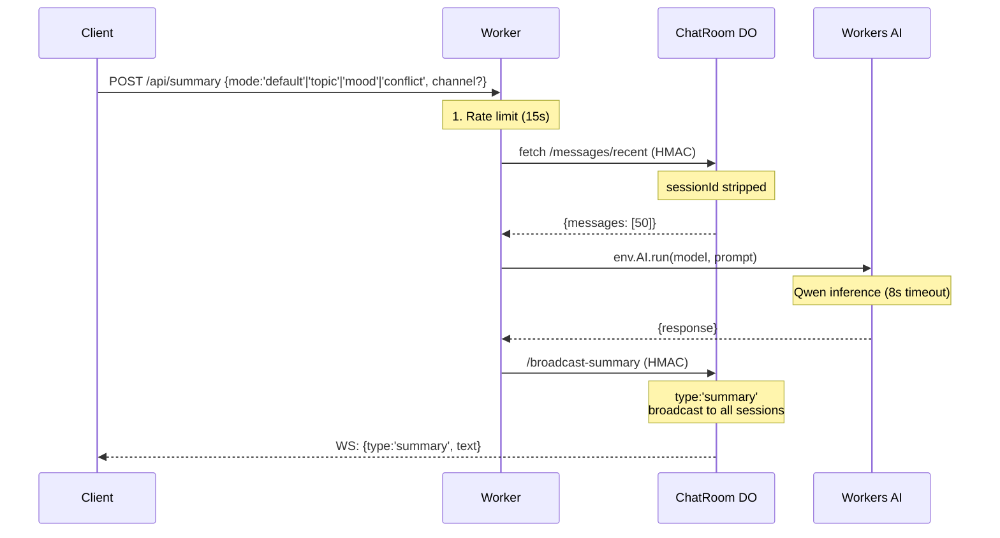
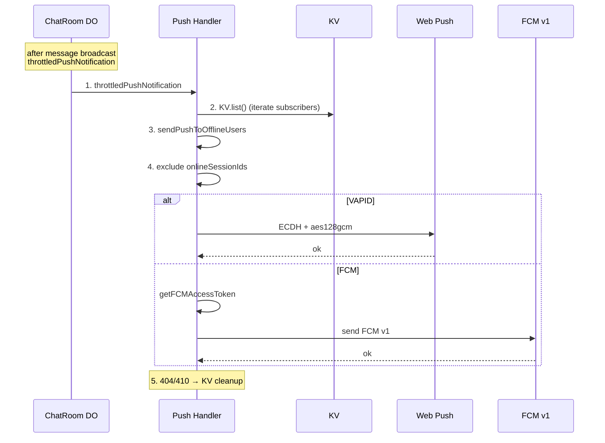

> 🌐 **English** | [한국어](./ARCHITECTURE.md)

> ℹ️ This is an English translation of [ARCHITECTURE.md](./ARCHITECTURE.md). The Korean version is canonical and may be more up to date.

# Architecture

> Anonymous Chat's system architecture and data flow

---

## Table of Contents

1. [System Overview](#system-overview)
2. [Components](#components)
3. [Data Flows](#data-flows)
4. [Security Boundaries](#security-boundaries)
5. [Build Pipeline](#build-pipeline)
6. [Performance Characteristics](#performance-characteristics)
7. [Extension Points](#extension-points)

---

## System Overview



---

## Components

### 1. Worker (`src/worker.js`, 558 lines)

Cloudflare Workers entry point (static assets are served through the `[assets]` binding). HTTP routing, WebSocket upgrades, and static asset fallback handling.

**Route Table**

| Category | Count | Path |
|---|---|---|
| Public endpoints | 22 | `/api/*`, `/ws`, `/metrics`, `/health` |
| Admin endpoints | 32 | `/api/admin/*` (allowed methods specified per route) |
| SPA fallback | – | unmatched → `/index.html` |

**Main Helpers**

| Function | Responsibility |
|---|---|
| `matchRoute()` | Declarative route matching (supports a method or an array of methods) |
| `handleChannelCreate` / `handleChannelJoin` / `handleChannelList` | Channel create/join/list handlers |
| `serveStaticAssets()` | ASSETS binding + SPA fallback |
| `checkRateLimit()` | Lazy-init rate-limiter (Workers-compatible) |

---

### 2. ChatRoom Durable Object (`src/durable-objects/ChatRoom.js`, 1735 lines)

The core WebSocket handler. One instance per channel (1 main room + N channels).

**Responsibilities**

| Area | Description |
|---|---|
| Session management | `sessions` Map, `ipConnections` Map |
| Message storage | DO Storage 12 hours, max 2000 (96KiB byte cap) |
| Bans | IP + SessionID |
| Announcements | Normal/emergency + scheduling |
| Reactions | Emoji toggle |
| Push | Offline users |
| AI summary | Workers AI calls |
| Auto cleanup | Schedules a DO alarm on last leave → empty channel self-deletes (10-minute TTL) |

**Helper Modules**

| File | Lines | Responsibility |
|---|---|---|
| `chat-room/admin.js` | 1156 | 19 `/admin/*` routes (including ban-ip, verify-session) |
| `chat-room/messages.js` | 218 | validation, search, AI sanitization |
| `chat-room/announcements.js` | 5 | `isEmergencyActive` helper |

**WebSocket Message Types**

| Direction | Count | Types |
|---|---|---|
| Inbound | 7 | `ping`, `join`, `message`, `edit`, `delete`, `reaction`, `typing` |
| Outbound | 19 | `handshake`, `pong`, `banned`, `history`, `announcement`, `system`, `error`, `message`, `message_edited`, `message_deleted`, `message_reaction`, `typing`, `user_count`, `emergency_cleared`, `summary`, `kicked`, `all_messages_deleted`, `admin_event`, `channel_deleted` |

---

### 3. ChannelRegistry Durable Object (`src/durable-objects/ChannelRegistry.js`, 418 lines)

Channel metadata singleton. Maps slug → channel info.

**Responsibilities**
- Channel create/read/delete
- `lastActive` refresh
- Empty-channel auto cleanup (alarm-only — no sweep on fetch, minimum 5-minute interval, verifies activeConnections is 0 before deletion)
- Admin channel list/force delete

---

### 4. DeadDropStore Durable Object (`src/durable-objects/DeadDropStore.js`, 183 lines)

One-time secret message singleton.

**Features**
- 30-minute TTL
- Permanently deleted after a single read
- 10,000-character limit
- 404/410 distinguishes expired/consumed
- DO alarm-based expiry cleanup (reschedules to the earliest expiry on save; on alarm, cleans up and then reschedules/deletes)

---

### 5. Handlers (`src/handlers/`)

| File | Lines | Responsibility |
|---|---|---|
| `admin.js` | 675 | 24 handlers (login + 23 withAuth types, including observer-ticket) |
| `websocket.js` | 136 | WebSocket upgrade + observer ticket/ban pre-checks |
| `push.js` | 351 | VAPID/FCM subscription management + delivery |
| `summary.js` | 216 | Workers AI summary (4 modes, 15-second rate limit) |
| `preview.js` | 279 | OG tag scraper (1-hour edge cache, SSRF denylist) |
| `turnstile.js` | 183 | Cloudflare Turnstile verification + Turnstile/observer ticket issuance and verification |
| `health.js` | 17 | `/health`, `/metrics` |

---

### 6. Middleware/Utilities

| File | Responsibility |
|---|---|
| `middleware/auth.js` | Opaque KV token issuance/verification (12-hour sliding), rate limit |
| `utils/do.js` | DO routing (`getChatRoom`, `getChannelRoom`, `forwardToDO`) |
| `utils/validate.js` | Message/channel/nickname/session/Dead Drop validation |
| `utils/errors.js` | `jsonError`, `jsonSuccess`, `textError`, `emptyResponse` |
| `utils/helpers.js` | `sanitizeInput`, HMAC helpers, `safeJson` |
| `utils/rate-limiter.js` | In-memory window counter |
| `utils/security.js` | `constantTimeCompare`, `isAllowedOrigin` |
| `utils/security-classifier.js` | XSS/SQL/path traversal pattern matching (22 event types classified) |
| `utils/risk-scorer.js` | Risky IP scoring based on time weighting + category diversity |
| `utils/security-logger.js` | D1 security_events writes + 60-second dedup + 90-day cleanup |
| `utils/logger.js` | D1 admin/audit/error logger + security event re-export |
| `utils/web-push.js` | VAPID JWT + RFC 8291 encryption |
| `utils/fcm-auth.js` | Google OAuth JWT for FCM v1 |
| `config/constants.js` | All magic numbers (shared server + client) |
| `config/cors.js` | CORS headers |
| `constants/security-events.js` | 22 security event definitions (category/severity/score) |

---

## Data Flows

### 1. Message Send (most frequent path)



### 2. WebSocket Handshake (Ephemeral Token)



### 3. Channel Create/Join



### 4. AI Summary



### 5. Push Notifications (offline users)



---

## Security Boundaries

### Authentication Token Types

| Type | Format | Location | Characteristics |
|---|---|---|---|
| **Admin token** | opaque 32-byte random value (KV `token:<t>`) | `auth.js` | 12-hour sliding TTL, KV revoked on logout, automatic logout on 401 |
| **Observer ticket** | `HMAC(observer:<sessionId>:<ts>)` | `handlers/admin.js` + `handlers/turnstile.js` | `POST /api/admin/observer-ticket` issues with a 5-minute TTL, verified by `/ws` (admin token not exposed in the URL) |
| **Internal token** | `X-Admin-Internal-Token` | `worker.js` ↔ DO | SSRF prevention |
| **Message signature (Ephemeral Token)** | `HMAC(sessionSecret, JSON.stringify({content, sessionId, timestamp}))` | `ChatRoom.js` + `signature.js` | 32-byte per-session secret + capability key (rotated on re-entry), authorId (16hex) replaces sessionId, ±30-second freshness, discarded on close/4401 |

### Rate Limiting

| Layer | Location | Rule |
|---|---|---|
| **Global** | `src/utils/rate-limiter.js` | per-worker in-memory, 5-minute cleanup |
| **Per-endpoint** | `API_RATE_LIMIT` constants | metrics, health, config, turnstile, upload, push, check-ban, logs/error, preview, summary, secret-store/read, announcements/emergency, channels, search, vapid, ws |
| **Admin API** | `src/worker.js` (`API_RATE_LIMIT.ADMIN`) | `/api/admin/*` 120 requests/minute per IP |
| **Per-user** | ChatRoom | 1-second cooldown, 30/minute sliding window (reactions 3s, typing start 2s throttle) |
| **Admin login** | `checkRateLimit`/`incrementRateLimit` | blocked after 5 attempts/5 minutes |

### Input Validation

| Input | Function | Rule |
|---|---|---|
| Message | `validateClientMessage` | branches by type |
| Dead Drop | `validateDeadDropMessage` | ≤10,000 characters |
| Channel name | `validateChannelName` | ≤20 characters, trim |
| Nickname | `validateNickname` | ≤12 characters, trim |
| sessionId | `validateSessionId` | `[a-zA-Z0-9_-]{1,200}` |
| File | `validateFileInfo` | url/filename/filetype lengths |
| Strings | `sanitizeInput` | strip control characters + normalize line breaks |

### Data Retention

| Data | Retention | Auto-deletion |
|---|---|---|
| Messages | 12 hours (memory + DO Storage) | ✅ (5-minute cleanup) |
| Announcements | permanent, history max 100 (memory + DO Storage) | manual |
| Dead Drop | 30-minute TTL, deleted after a single read | ✅ TTL + DO alarm |
| Audit logs | D1 (audit_logs, 90 days) | ✅ periodic forced sweep (1 in 10) + probabilistic |
| Admin logs | D1 (admin_activity_logs, 30 days) | ✅ periodic forced sweep (1 in 10) + probabilistic |
| Error logs | D1 (error_logs, 30 days) | ✅ periodic forced sweep (1 in 10) + probabilistic |
| Security events | D1 (security_events, 90-day retention) | ✅ periodic forced sweep (1 in 10) + probabilistic |
| Push subscriptions | 30-day TTL (KV) | ✅ TTL |
| Bans | expire according to the time setting (permanent option) | ✅ on expiry |
| Session capability keys | KV (30-minute TTL, max 500) | ✅ TTL (keys for connected sessions are excluded from eviction) |

---

## Build Pipeline

```mermaid
flowchart LR
    subgraph Server["Server"]
        Worker1[src/worker.js<br/>ESM]
        Worker1 --> Runtime[Cloudflare Workers<br/>+ Static Assets (public/)]
    end

    subgraph Client["Client"]
        Chat[public/js/chat.js<br/>+ 30 source modules + 6 page wrappers]
        Admin[public/js/admin-core.js / admin-ui.js / admin-main.js<br/>+ security-center.js + 6 pages]
        TailwindB[tailwind build<br/>45KB]

        Chat -->|esbuild| ChatBundle[chat.bundle.js]
        Admin -->|esbuild| AdminCore[admin-core.bundle.js]
        Admin -->|esbuild| AdminPages[admin-*.bundle.js<br/>+ security-center.bundle.js<br/>10 bundles total]
        Tailwind -.->|replacement| TailwindB
    end
```

**Client Bundle Note**: Prism.js is bundled locally through the `code-highlight.js` entry and does not use a CDN script (`_headers` CSP keeps `script-src 'self'`).

---

## Performance Characteristics

| Metric | Result |
|---|---|
| Message history loading | 100 messages, 500ms → **20ms** (25x, DocumentFragment) |
| Event listeners | 5-6 per message → 5 on the container (delegation) |
| Tailwind | 300KB CDN → **45KB** build |
| Bundles | 19 modules → **10** (chat, admin-core, admin-main, 6 admin pages, security-center) |
| WS Reconnect | exponential backoff, max 10 attempts/30s |
| AI Timeout | 8 seconds + 15-second rate limit |
| OG Cache | 1-hour edge + 50-client memory |
| Push Throttle | 1.5 seconds (debounce) |

---

## Extension Points

| Target | Location | Procedure |
|---|---|---|
| New DO | `src/durable-objects/` | register in `wrangler.toml` `[[durable_objects.bindings]]` |
| New route | `worker.js` | add to the `routes` array |
| New handler | `src/handlers/` | add a module, import it in `worker.js` |
| New constants | `src/config/constants.js` | shared server + client |
| New theme | `themes.css` | add CSS Custom Properties, add to the `theme.js` `THEMES` array |
| New mixin | `public/js/ui-*.js` | attach via `Object.assign` at the end of `ui.js` |
